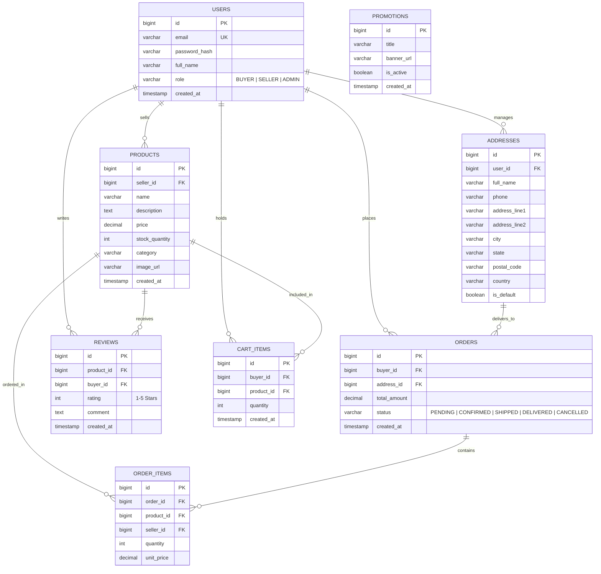

# RasheedhaMart Entity-Relationship (ER) Diagram

This document describes the complete relational database architecture for **RasheedhaMart**, a full-stack multi-vendor e-commerce platform.

## Mermaid ER Diagram

## Schema Entities & Relationships

1. **USERS**: Represents system actors with roles (`BUYER`, `SELLER`, `ADMIN`). Admin accounts are seeded in database and cannot be registered publicly.
2. **PRODUCTS**: Multi-vendor product catalog listings tied to `SELLER` user IDs with price, stock, and category attributes.
3. **ADDRESSES**: Saved shipping destinations per `BUYER` user, supporting default flags and detailed postal fields.
4. **CART_ITEMS**: Active shopping cart items per `BUYER` with automatic duplicate aggregation and quantity tracking.
5. **ORDERS & ORDER_ITEMS**: Atomic transaction records linking buyer, selected shipping address, snapshot order items, seller IDs, subtotal, and progressive lifecycle status.
6. **REVIEWS**: Verified customer ratings (1 to 5 stars) and feedback restricted to buyers who purchased and received the target item.
7. **PROMOTIONS**: Platform marketing banners and active campaign announcements managed exclusively by `ADMIN`.
