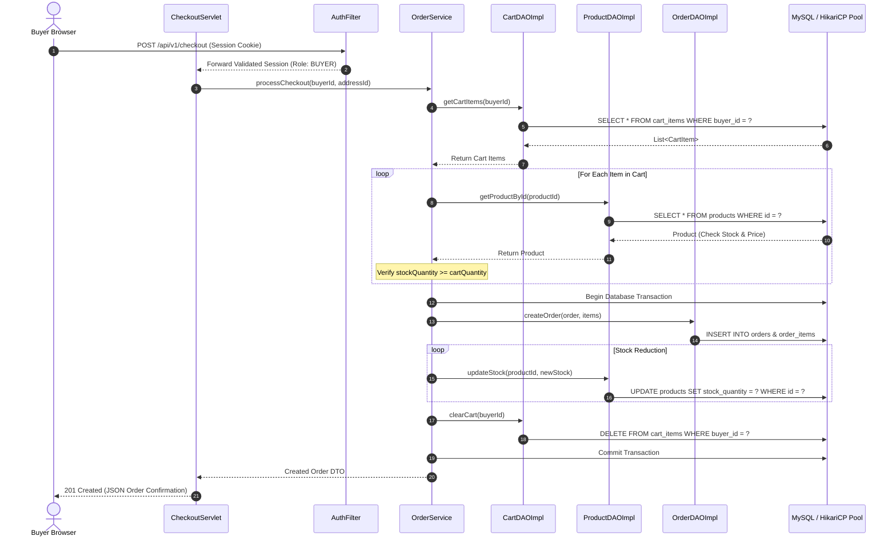
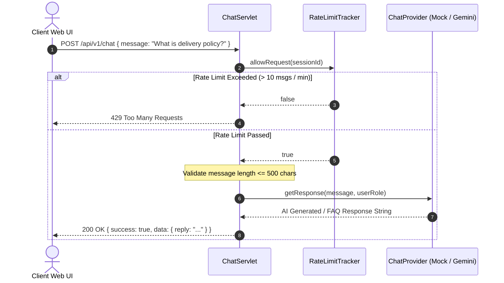

# RasheedhaMart Sequence Diagrams

This document details the core runtime interactions across system components for **RasheedhaMart**.

## 1. Checkout & Order Generation Flow

## 2. AI Chatbot Interaction Flow

