# RasheedhaMart Use Case Diagrams

This document defines the primary actors and use cases across the **RasheedhaMart** application.

## Mermaid System Architecture & Use Case Flow

```mermaid
flowchart TD
    subgraph Actors
        B[Buyer]
        S[Seller]
        A[Admin]
    end

    subgraph AuthModule["Authentication & User Management"]
        UC1[Register Account]
        UC2[Login & Session Init]
        UC3[View & Manage Profile]
    end

    subgraph BuyerModule["Buyer Services"]
        UC4[Search & Filter Products]
        UC5[Manage Delivery Addresses]
        UC6[Manage Cart Items]
        UC7[Execute Checkout & Mock Payment]
        UC8[Track Order Delivery Status]
        UC9[Submit Product Reviews & Ratings]
        UC10[Interact with AI Chatbot]
    end

    subgraph SellerModule["Seller Services"]
        UC11[Manage Product Listings CRUD]
        UC12[View Incoming Orders & Sales Summary]
        UC13[Update Order Fulfillment Status]
    end

    subgraph AdminModule["Admin Services"]
        UC14[Platform User Moderation]
        UC15[Global Order Monitoring]
        UC16[Manage Promotional Marketing Banners]
        UC17[Inspect Financial Analytics & Profit/Loss]
    end

    B --> UC1
    B --> UC2
    B --> UC3
    B --> UC4
    B --> UC5
    B --> UC6
    B --> UC7
    B --> UC8
    B --> UC9
    B --> UC10

    S --> UC2
    S --> UC3
    S --> UC11
    S --> UC12
    S --> UC13

    A --> UC2
    A --> UC14
    A --> UC15
    A --> UC16
    A --> UC17
```

## Functional Requirements Summary

### 1. Buyer Persona
- Browse catalog with keyword and category filtering.
- Manage saved delivery addresses and toggle default.
- Server-validated cart management (stock checks & subtotal calculations).
- Multi-step checkout with address selection & mock payment confirmation.
- Track order progression (`PENDING` -> `CONFIRMED` -> `SHIPPED` -> `DELIVERED`).
- Verified product review submission.
- Real-time AI chatbot assistance for FAQs and platform support.

### 2. Seller Persona
- Create, update, list, and soft-delete owned products.
- View incoming buyer orders for owned products only.
- Update order lifecycle status to drive fulfillment.

### 3. Admin Persona
- System Administrator access via seeded database credentials only.
- User account moderation (view/delete).
- Global order audit.
- Marketing banner management (create, toggle active state, delete).
- Real-time Profit & Loss Financial Analytics dashboard (Gross Revenue, Estimated Costs, Net Profit, Sales Breakdown by Category).
